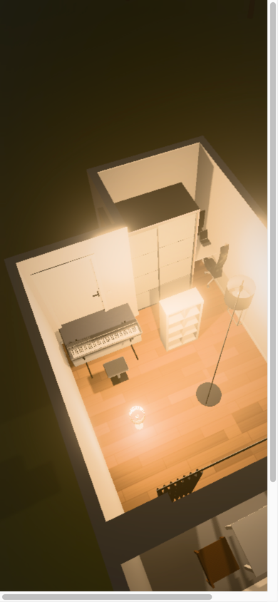

# Experience cold startup

Follow-up against PR head `dc280f2`. The previous interaction benchmark imported
the renderer before navigation, so it did not measure the complete cold startup.
The Vercel preview requires authentication in the available browser; these checks
serve the same production build locally, with injected instrumentation before the
app and no pre-imports of app code.

## Causes and implementation

1. **Model transfers were late and large.** Downloads began after renderer code
   loaded and an initial stand-in Room was built. The eight required GLBs total
   2,678,280 bytes. Repeat visits reuse the decoded model cache, explaining much
   of their speed advantage.
2. **Shader submission was serial.** Each lighting variant was submitted, awaited
   and rendered before the next variant started. The driver's compiler could not
   work on the later variants during earlier waits.
3. **Hidden warmup rendered full-size images.** Every light state ran the whole
   postprocessing pipeline behind the opaque loader.
4. **Sun-state scanning repeatedly constructed time-zone formatters.** A local
   200-call diagnostic took 27.4 ms versus 0.18 ms using one formatter. This is a
   microbenchmark, not an end-to-end speedup claim.

The build now generates `.glb.gz` sidecars using Node's built-in gzip. All eight
sidecars decompress **byte-for-byte to the original GLBs**, totaling 1,776,563 bytes
(**33.7% fewer model bytes**). No model, texture, geometry or source asset is
modified. Production loaders use native decompression when available. Missing or
corrupt sidecars fall back to original GLBs; browsers without decompression load
originals directly. A GLB-header check handles hosts that already decompress the
HTTP response. Development retains the original URLs. Node 24 type declarations
are a development dependency; no runtime dependency was added.

Reactive preload links discover the exact required Room Fixtures and Piece/Packet
models. Their URL and anonymous fetch credentials match the model loader, so the
preload response is consumed once. Critical renderer module requests start first,
then low-priority model preloads overlap their download. An earlier experiment
started model preloads before the renderer request; it occupied HTTP/1 connections
and delayed critical JavaScript. That request order was corrected.

Lighting preparation first submits every shader variant through `compile()`, then
checks readiness sequentially through `compileAsync()`. This uses public Three.js
APIs and preserves the original materials' cached program references. Readiness
checks remain sequential because Three tracks each material's current program.
The existing rebuild-version checks, shared promise, latest requested state,
disposal guards and visible loader remain intact.

Hidden color/postprocessing warmup uses 32×32 buffers. Shadow maps keep their
production sizes. A `finally` block restores current dimensions, and a full-size
frame in the requested lighting state renders before the loader is removed.
The same formatter is reused for sun calculations; the offset is still evaluated
for each date, preserving DST transitions.

## Production-build measurements

M3 host, Chromium, production phone path at 390×844, full eight-Piece Draft.
Fresh document and WebGL context, HTTP `no-store`; browser/OS/driver caches may
remain warm. The test server adds per-response latency and optionally shares one
aggregate bandwidth budget across requests. This is a reproducible connection
simulation, **not a physical-phone or live-deployment measurement**.

| Case                                                              |   Before |  Updated |
| ----------------------------------------------------------------- | -------: | -------: |
| Cold loader visible, 120 ms latency / 6 Mbps (two-run mean)       | 5,432 ms | 3,916 ms |
| Navigation start → loader removed, same connection (two-run mean) | 6,562 ms | 4,996 ms |
| Repeat visit loader visible                                       | 1,353 ms |   995 ms |
| Cold loader visible, 80 ms latency / uncapped bandwidth           | 1,636 ms | 1,074 ms |
| Navigation start → loader removed, same uncapped connection       | 2,259 ms | 1,670 ms |

The constrained test reproduces a loading screen lasting over five seconds. The
updated mean loader duration is **27.9% shorter**, saving 1.52 seconds; total page
startup saves 1.57 seconds. The two constrained loader samples were 5.35–5.52 s
before and 3.87–3.96 s after. The uncapped loader duration is **34.4% shorter**.
The other rows are individual diagnostic runs; none is a statistically
representative latency guarantee.
Network speed, CPU/GPU compilation and real-device memory remain practical limits.

Incremental uncapped production diagnostics (80 ms response latency):

| Iteration                                          | Total startup | Loader visible |
| -------------------------------------------------- | ------------: | -------------: |
| Previous PR head                                   |      2,259 ms |       1,636 ms |
| Submit all shader variants before readiness checks |      1,959 ms |       1,265 ms |
| Add small buffers and early model preloads         |      2,014 ms |       1,297 ms |
| Reuse formatter                                    |      1,786 ms |       1,129 ms |
| Order renderer requests before preloads            |      1,701 ms |       1,126 ms |
| Add lossless compressed model delivery             |      1,670 ms |       1,074 ms |

The combined early-preload/buffer experiment initially regressed total startup
relative to queueing alone, exposing the HTTP/1 request contention described above.
Intermediate timings are affected by cache state and run-to-run variation; source
ordering, transfer counts, byte totals and final behavior support the conclusions.

After the constrained cold load, first evening / lights-on / daylight actions
completed in 18.2 / 32.0 / 32.8 ms to the second animation-frame callback, with
**zero new programs and no long tasks**. This is not input-to-photon latency.
Every successful compressed model had exactly one resource transfer; no original
GLB was additionally requested. All production fallback runs reached readiness
with the full scene and 129 programs, without unhandled errors.

## Quality and lifecycle verification

- Phone: matched day, night, twilight and indoor images are pixel-identical
  (block-luma SSIM 1.0, RGB MAE 0). Actual render buffers remain 468×1012.
- Desktop: buffers remain 1600×1000; three comparisons, sampled at 390×844, score
  SSIM 0.99794–0.99972 and RGB MAE 0.069–0.175 /255. Separately created AO noise
  differs. This is not a full-resolution desktop perceptual study.
- Both paths: every slider value with lamps on/off plus all camera viewpoints
  creates zero additional programs, with no shader failures or WebGL errors.
- Preparation interrupted by a rebuild resolves for the latest Room, time and
  lamp state. Concurrent callers share its promise. Disposal during preparation
  resolves false without another render.
- Winter, summer and both sides of the 2026 spring/autumn DST transitions match
  the expected solar-time offsets.
- Missing sidecars, invalid gzip, absent `DecompressionStream` and pre-decoded HTTP
  responses all retain original model loading. All generated sidecars were
  gunzip-compared with their originals.



`npm run check`, `npm run lint`, `npm test` (15 files / 162 tests) and
`npm run build` passed. Svelte autofixer reports no issues. Read-only source
review found no blocking issue in the final implementation.

## Reproduction

Build with `npm run build`. Serve the output with:

```sh
node scripts/benchmarks/serve-startup.mjs .vercel/output/static 4187 120 6
```

Open `/experience?phone` in an isolated profile at 390×844. The server injects
[startup-probe.js](../scripts/benchmarks/startup-probe.js) before application code,
populates only the isolated local Draft, and serves no database/server routes.
Read `startupReport` and `startupResources()` once `visits[0].ready` is set. Invoke
`startupActions()` to check first lighting actions. Serve the archived baseline
output on a different port for comparison. Sidecar fallback modes are the optional
last server argument `missing`, `corrupt` or `encoded`; `?no-decompression` tests
browsers without native decoding.

For matched-source quality and complete shader sweeps, run
`node scripts/benchmarks/prepare-startup.mjs`, start the dev server and open
`/startup-benchmark.html`. Use `showStartup(true)` for the previous class and
`showStartup(false)` for the current one, `captureStartup()` / `compareStartup()`
for frozen images and `startupSweep()` for lighting/viewpoints. Pass false as the
second argument to select the desktop path. Run `prepare-startup.mjs --clean`
**before type-checking, linting or building**; temporary routes/baselines are never
included in production. The existing cold-lifecycle browser script tests rebuild
and disposal against the current renderer.

[Raw timings, resource transfers, iterations and QA](benchmarks/startup-performance.json).
The native decoding API follows the [Compression Standard](https://compression.spec.whatwg.org/).
