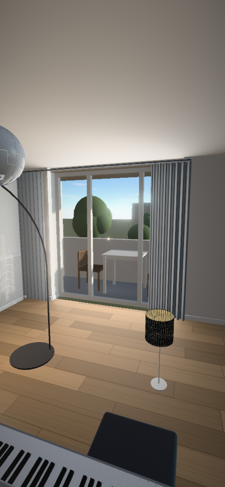
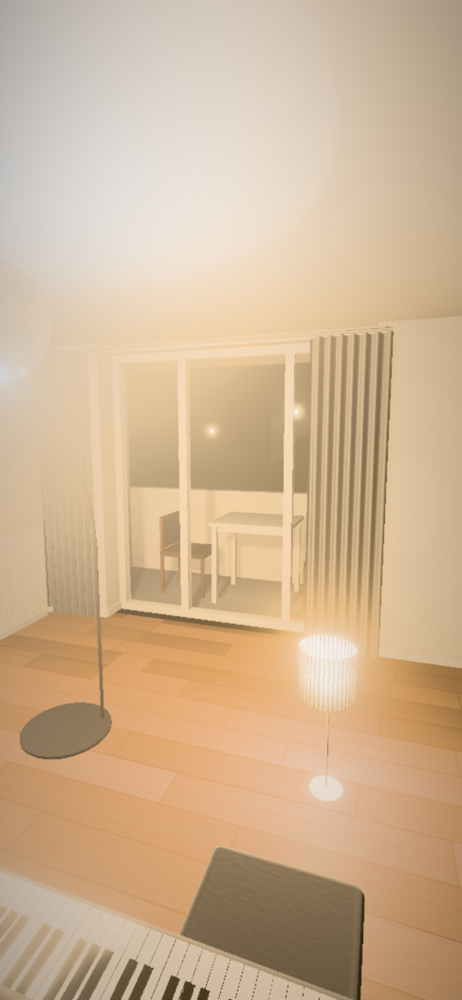

# Mobile preview performance

This follow-up compares the updated preview with the **current PR's previous head,
`4478db13b0c21f8ac58297b139057aaf2cad2210`**, including its original model assets.
It uses the current Room and Inventory, not the older pre-rebase baseline.

**Result:** aggregate sustained GPU throughput improves **2.11×**. A conservative
budget using **8× slower GPU work and 10× slower CPU submission** improves **2.17×**.
These are phone-path workload measurements on an M3 host and explicit budget
projections, **not measurements on physical Android/iOS devices**.

## Changes retained

- Batch owned opaque Room meshes by material and shadow flags. Leave roof visibility,
  transparent glass, nested meshes and shared GLBs independent. Cache world matrices
  after each build; reset the root's update flags before rebuilding.
- Instance distant scenery within quadrants, retaining culling without duplicating
  the shared tree vertex buffers. Reduce distant crown subdivision from 3 to 2;
  retain the same procedural tree positions, colors and sizes.
- Hide zero-intensity lights so shaders omit their lighting loops.
- Use packed **R11F_G11F_B10F** color targets on phones when float rendering and the
  required multisampling are supported. This uses 4 bytes per color texel instead
  of RGBA16F's 8. Keep RGBA16F as the capability fallback. The preview is opaque;
  desktop color precision, the phone's 2× geometry MSAA and full bloom remain.
- Cap phone supersampling at **1.20×**, versus 1.25× before. Desktop stays at 1.25×.
  This reduces internal pixel work by about 8%; it is not pixel-identical output.
- Simplify two over-tessellated models offline, preserving material/normal seams
  with a geometric error cap of 0.05% of primitive radius:

| Model          | Previous triangles | Current triangles | Previous bytes | Current bytes |
| -------------- | -----------------: | ----------------: | -------------: | ------------: |
| Ceiling lamp   |             90,947 |            19,503 |        576,752 |       135,404 |
| Keyboard stand |             92,850 |            20,399 |        767,756 |       147,572 |

The two assets have **78% fewer triangles and 79% fewer download bytes**. The
optimizer validates source/output hashes: repeat runs skip optimized files,
and changed source assets require review instead of accumulating simplification
error. Run `node scripts/optimize-preview-models.ts` after regenerating models.

There is no adaptive quality controller, sky cache, new runtime dependency,
change to the Inventory, or change to the newer UX/loading flows.

## Measurement method

- Chrome, ANGLE Metal / Apple M3, November 7, 2026. Explicitly activate the production
  phone path using a coarse pointer and a 390-pixel screen short side. Confirm
  `scene.phone === true`; resizing a desktop tab alone would not test this path.
- Test 390×844 and 844×390 CSS canvases with every real model preloaded. The repeatable
  placement exercises every Piece; it is not a publishable Design. No database access.
- Furnished door, window and overhead views, night with lamps, and a moving camera tour.
- Warm shaders and model uploads. Compare baseline/updated in ABBA order over two
  repeats. Each case uses **48 GPU queries of eight consecutive renders**, normalized
  per render: 7,680 timed renders per variant across both orientations.
- Use `EXT_disjoint_timer_query_webgl2`; reject disjoint/incomplete queries, shader
  compilation failures and WebGL errors. Record CPU submission separately.
- Batched queries measure **sustained rendering throughput under load**, not display
  FPS or worst individual-frame latency. Isolated RAF-paced queries were noisy with
  idle/power-state changes; their earlier results are retained separately.
- A separate 300-frame, single-render-per-RAF tour measures presentation stability.
  It averages **60.19 FPS**, p95 frame interval **17.7 ms**, on the host. This does not
  establish the same FPS on phones. Startup and first-use shader compilation are
  excluded from steady-state measurements.

## Results

Values below average the two repeat medians in each case. Speedups are ratios of
summed case medians, not averages of individual speedup ratios.

| Orientation / view     | Previous GPU ms/render | Updated GPU ms/render | Speedup |
| ---------------------- | ---------------------: | --------------------: | ------: |
| Portrait: door/day     |                   4.01 |                  2.06 |   1.95× |
| Portrait: window/day   |                   3.48 |                  1.61 |   2.16× |
| Portrait: above/day    |                   3.05 |                  1.36 |   2.25× |
| Portrait: door/night   |                   4.04 |                  1.64 |   2.46× |
| Portrait: moving tour  |                   3.59 |                  1.84 |   1.95× |
| Landscape: door/day    |                   4.38 |                  2.24 |   1.96× |
| Landscape: window/day  |                   4.18 |                  2.18 |   1.92× |
| Landscape: above/day   |                   3.11 |                  1.41 |   2.20× |
| Landscape: door/night  |                   4.27 |                  1.82 |   2.35× |
| Landscape: moving tour |                   4.34 |                  2.08 |   2.09× |

Aggregate GPU speedup: **2.14× portrait, 2.09× landscape, 2.11× combined**.
Some individual views remain below 2×; the aggregate acceptance target exceeds it.

### Conservative device budgets

Model a frame as `GPU median × GPU slowdown + CPU median × CPU slowdown`.
Adding CPU and GPU work assumes no overlap and includes submission/backpressure
in CPU time, so it is intentionally conservative. These multipliers are chosen
stress assumptions, not measured specifications or emulation of a named phone.

| GPU / CPU slowdown | Previous mean budget | Updated mean budget | Improvement |
| ------------------ | -------------------: | ------------------: | ----------: |
| 4× / 6×            |             20.53 ms |             9.42 ms |       2.18× |
| **8× / 10×**       |         **39.35 ms** |        **18.13 ms** |   **2.17×** |
| 12× / 16×          |             59.89 ms |            27.55 ms |       2.17× |

The stronger scenarios do **not** guarantee 60 FPS: 18.13 ms is already above a
16.67 ms frame budget, and individual cases/tails vary. Driver behavior, thermal
throttling and memory limits need real-device profiling. This work meets the
aggregate 2× improvement target without claiming universal full FPS.

[Final measurements](benchmarks/mobile-final.json) contain all measured component
costs and image comparisons. [QA results](benchmarks/mobile-qa.json) include the
single-frame tour, forced RGBA16F fallback, sunset rendering, resize, rebuild and
close-ups. A separate rebuild check confirmed a Piece moved from x=80 to x=90 cm
has world x=0.9 m after resetting/refreezing transforms.

## Preview quality

Images are compared at identical CSS dimensions. The harness computes luma SSIM
on non-overlapping 8×8 blocks and RGB mean absolute error. This is an inexpensive
full-reference metric, not a human study or standard Gaussian-window SSIM.

Final phone comparisons score **0.981–0.986 SSIM**, with maximum case-average RGB
error **1.92/255**. The 1.20× supersampling cap changes edge sampling; packed HDR
also reduces color precision, especially in blue. Neither is claimed lossless.
Matched day/night screenshots at normal phone size showed comparable furniture,
lighting and material detail; no obvious additional gradient banding was apparent.

Desktop close-ups isolate the simplified assets from the phone resolution change:
ceiling lamp **0.9977 SSIM / 0.23 RGB MAE**, keyboard stand **0.9989 / 0.10**.
Some AO noise differs between independently constructed desktop scenes.

| Before: phone/day                                       | After: phone/day                                      |
| ------------------------------------------------------- | ----------------------------------------------------- |
|  |  |

| Before: phone/night                                           | After: phone/night                                          |
| ------------------------------------------------------------- | ----------------------------------------------------------- |
|  |  |

### Iterations and rejected approaches

Raw records are retained to avoid presenting only the successful result:

- [Lights + scenery batching](benchmarks/mobile-iteration1.json): nearly identical
  images, insufficient improvement alone.
- [Add bounded model simplification](benchmarks/mobile-iteration2.json): close images,
  still insufficient alone.
- [Room batching + half-size bloom](benchmarks/mobile-candidate.json): rejected;
  night SSIM fell to 0.958 and the glow spread changed.
- [Packed HDR + frozen transforms](benchmarks/mobile-packed.json): retained, but the
  isolated-frame timing method did not provide a stable throughput estimate.
- [Native-resolution candidate](benchmarks/mobile-native-candidate.json): faster,
  rejected for greater edge-sampling differences (SSIM as low as 0.976).
- [Full 1.25× portrait](benchmarks/mobile-portrait.json) and
  [landscape](benchmarks/mobile-landscape.json): conservative budget improved, but
  raw GPU throughput lacked margin in landscape.
- [Cached sky candidate](benchmarks/mobile-sky-candidate.json): rejected; refresh
  work, memory and extra state did not justify the gain. No sky cache is shipped.
- [Final](benchmarks/mobile-final.json): use the smaller 1.20× phone adjustment,
  original full bloom and live sky, with the accumulated geometry/CPU/HDR changes.

Earlier isolated-frame records have `samples` with no `batchSize` (one render per
query). Later records specify eight-render batches. Some early batch counters are
per batch; final counters are normalized per render. These methods should not be
compared as if they were one continuous timing series; each run has its own baseline.

## Reproduce and validate

```sh
node scripts/benchmarks/prepare-mobile.mjs
npm run dev -- --host 127.0.0.1
```

Open `/mobile-benchmark.html` in a disposable browser tab. The preparation script
creates separate renderer modules and GLB URLs from the previous PR commit, so
both versions do not accidentally load the newly optimized assets. In the console:

```js
const reports = {
	portrait: await run({ samples: 48, repeats: 2 }),
	landscape: await run({ samples: 48, repeats: 2, width: 844, height: 390 })
};
console.log(JSON.stringify(reports, null, 2));
```

Do not run overlapping benchmarks, builds or checks during measurement. Restart
Vite after code changes to avoid stale transformed modules. The canvas dimensions
and phone-path selection are controlled explicitly; this does not emulate a phone
GPU or user agent. The placement, geometry and camera trajectory match both versions.

Before production checks/builds, remove all temporary benchmark inputs:

```sh
node scripts/benchmarks/prepare-mobile.mjs --clean
npm run check
npm test
npm run lint
npm run build
```

The prepare/clean roundtrip and optimizer's already-optimized path were exercised.
No benchmark route, baseline model, instrumentation or experimental sky renderer
is included in the production build.
