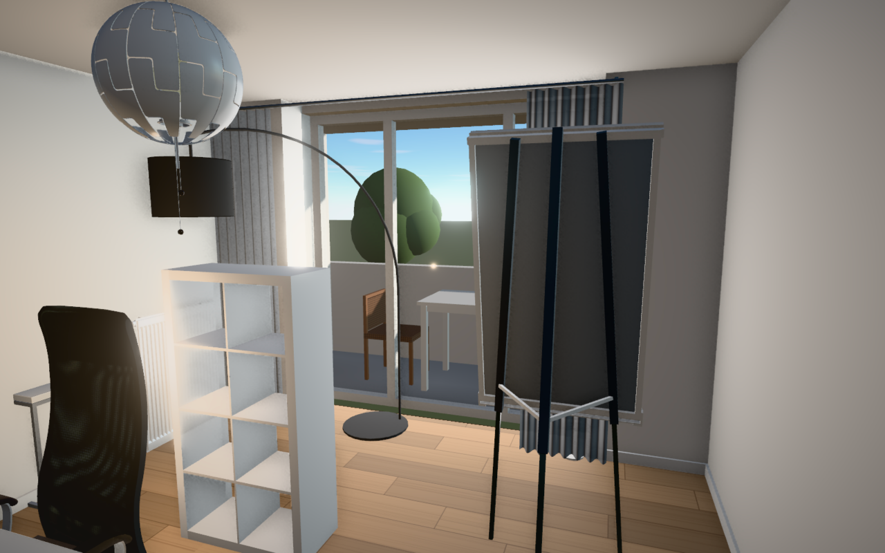

# Experience preview performance

> Historical measurements: the results below compare the original PR against
> `94ad612`. PR #30 has since been rebased onto `07fa921` (latest main at rebase),
> preserving its revised Inventory, UX, loading feedback, idle throttling and
> phone rendering settings (2× MSAA, no AO). These numbers do not measure the
> incremental speedup over that newer main. Re-run the harness with a baseline
> generated from the newer commit to measure that comparison.

Measured on November 7, 2026, in Chrome / ANGLE Metal on Apple M3, with a
1280 × 800 CSS viewport. Baseline: `94ad612d9793526dd03ce164ed72f0185986e6fc`.
Every Piece and Fixture is loaded before timing. The deterministic placement is a
rendering workload, not a publishable Design. No database access is needed.

## Bottlenecks and changes

1. **Repeated static shadows.** Every scene render regenerated directional shadows
   and up to six point-light faces; GTAO renders the scene again for normals.
   Cache shadows and invalidate after Room/Piece rebuilds, time and lamp changes,
   and ceiling visibility transitions. Camera motion alone needs no shadow refresh.
2. **Multisampling fullscreen effects.** Both HDR composer buffers had 4× MSAA,
   causing unnecessary resolves throughout postprocessing. A small render pass now
   owns the 4× MSAA geometry target; fullscreen effects use depthless, single-sample
   buffers. Disable redundant canvas antialiasing.
3. **Redundant copies.** Compute GTAO without its two color-compositing passes,
   then combine AO with the existing HDR sanitizing pass. Apply the same vignette
   after color conversion inside OutputPass. Bloom, tone mapping, exposure, cloud
   animation, material detail and shadow-map resolutions are retained.
4. **Excess pixel work.** Compute broad contact occlusion at half backing-buffer
   dimensions. Cap supersampling at 1.25× instead of 1.5×; retain 4× geometry MSAA.
   This is a deliberate reduction of internal pixel counts, validated at the same
   displayed size, not a claim of pixel-identical output.
5. **Sky overdraw.** Render sky after opaque geometry so walls reject covered
   cloud-shader fragments before shading.
6. **Lifecycle.** Dispose installed postprocessing passes and permanent light
   shadows, including two materials omitted by the installed GTAOPass disposer.
   Prevent late model callbacks from rebuilding a disposed scene.

Production changes are confined to PreviewScene and one 24-line render pass.
No new dependency or adaptive quality state machine is required.

## Results

GPU timer queries (`EXT_disjoint_timer_query_webgl2`), 90 samples per case,
with eight warm-up frames. All reported queries were non-disjoint. FPS is measured
separately from requestAnimationFrame intervals. GPU elapsed queries are not the
same measurement as presentation intervals; do not derive FPS from these timings.

| Furnished view      | Baseline GPU median | Final GPU median | GPU speedup | Baseline FPS | Final FPS |
| ------------------- | ------------------: | ---------------: | ----------: | -----------: | --------: |
| Door, daylight      |            64.31 ms |         13.86 ms |       4.64× |         26.7 |      61.4 |
| Window, daylight    |            57.13 ms |         13.58 ms |       4.21× |         26.5 |      60.8 |
| Above, daylight     |            57.96 ms |         13.02 ms |       4.45× |         28.4 |      61.3 |
| Door, night + lamps |            57.46 ms |         14.45 ms |       3.98× |         28.0 |      59.8 |

The ratio of summed case medians is **4.31×**. This is GPU rendering throughput,
not a 4× increase in displayed FPS (which is capped around 60). The night case is
slightly below 4× in this run; the aggregate acceptance target exceeds 4×.

A 300-frame moving camera tour measured **60.24 FPS**, median 16.7 ms and p95
19.9 ms per frame. Manual checks confirmed roof transitions and time/lamp changes
invalidate shadows, and resizing to 800 × 600 produces a 1000 × 750 color buffer
and 500 × 375 AO buffer. Tests include loaded real models, not just stand-ins.

### Iterations and visual quality

[Raw initial iterations](benchmarks/preview-iterations.json) contain the original
pipeline, shadow caching, isolated geometry MSAA, and half-resolution AO, all at
1.5× DPR. [Final measurements](benchmarks/preview-final.json) contain baseline,
shadow caching, fused composition with full-resolution AO (`msaa`), and the final
half-resolution AO (`optimized`) at 1.25× DPR.

| Final-run iteration                               | Door GPU median | Door RGB mean absolute error / 255 | Door strip SSIM |
| ------------------------------------------------- | --------------: | ---------------------------------: | --------------: |
| Baseline                                          |        64.31 ms |                                  0 |          1.0000 |
| Shadow caching                                    |        49.54 ms |                               0.22 |          0.9991 |
| Fused composition, full AO, bounded supersampling |        19.31 ms |                               0.75 |          0.9940 |
| Final, half-resolution AO                         |        13.86 ms |                               0.96 |          0.9916 |

Final images are normalized to 1280 × 800 CSS pixels before comparison. The
reported strip SSIM is an inexpensive luminance structural-similarity proxy on
64-pixel horizontal strips, **not standard 2D-window SSIM or a human study**.
Across final cases it ranges from 0.9916 to 0.9961; RGB MAE ranges from 0.72 to
1.67 out of 255. Individual edge pixels differ more (maximum 134), so averages
alone do not establish quality. GTAO also randomizes its denoising noise between
scene instances, contributing to even shadow-only image differences.

Matched screenshot review at display size found comparable furniture detail,
window edges, floor texture and lighting, with slightly softer contact occlusion.
Geometry, 4× geometry antialiasing and the lighting design are preserved.

| Before                                                       | After                                                        |
| ------------------------------------------------------------ | ------------------------------------------------------------ |
|  |  |

These results validate the target on this machine. They do **not** establish 60 FPS
on every low-end GPU, resolution or refresh rate. Physical low-end/mobile hardware
was unavailable; that coverage remains a limitation. No arbitrary hardware can be
guaranteed full FPS while retaining a fixed visual-quality floor.

## Reproduce

Use a disposable browser tab; the harness replaces its contents with a canvas.
Temporary copies keep benchmark code out of the application bundle:

```sh
git show 94ad612d9793526dd03ce164ed72f0185986e6fc:src/lib/preview/PreviewScene.ts > src/lib/preview/PreviewScene.baseline.ts
cp scripts/benchmarks/preview.js src/lib/preview/benchmark.js
cp scripts/benchmarks/preview.html static/preview-benchmark.html
npm run dev -- --host 127.0.0.1
```

Open `/preview-benchmark.html` at a 1280 × 800 viewport with device pixel ratio at
least 1.5. In the browser console:

```js
runBenchmark({ samples: 90 }).then((result) => {
	window.benchmarkResults = result;
	console.log(JSON.stringify(result, null, 2));
});
```

Only one benchmark should run at a time. Use a dedicated page so an app preview
does not compete for GPU time. Restart Vite after changing benchmark code to avoid
stale transformed modules, and do not run builds during measurement. For an empty
Draft, pass `furnished: false`. Clean up before normal checks or committing:

```sh
rm src/lib/preview/PreviewScene.baseline.ts src/lib/preview/benchmark.js static/preview-benchmark.html
```

Validation: `npm run check`, `npm test` (108 tests), `npm run lint`, `npm run build`.
