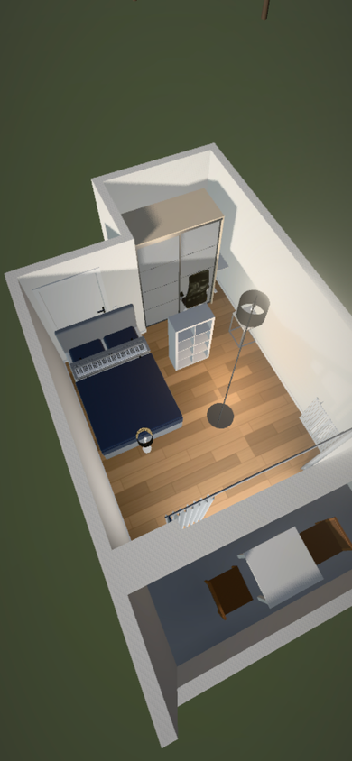
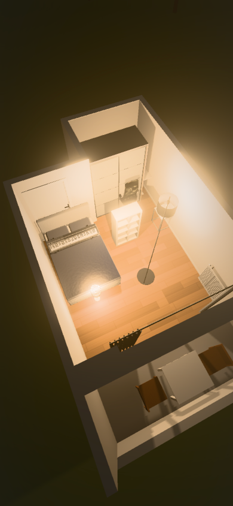
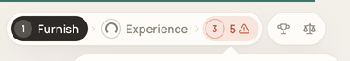
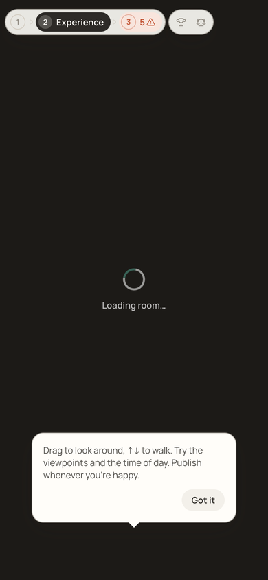

# Experience interaction responsiveness

Follow-up to the mobile throughput work, measured against PR head `60b79ea`.
The earlier steady-state benchmarks deliberately warmed shaders, so they did not
cover the first-use stalls addressed here.

## Cause and changes

- Navigation progress waited 150 ms. A synchronous WebGL constructor and the view
  transition snapshot could run before any loading feedback painted. Progress now
  starts immediately, the selected destination shows a spinner and accessible
  loading status, and navigation gives that feedback a paint before taking the
  transition snapshot. Query-only changes remain immediate. Native links retain
  their normal browser behavior.
- The Experience renderer is imported and constructed after the room loader
  paints. Its first animation frame no longer renders an empty scene on mount.
- Previously, hiding zero-intensity lights saved steady-state rendering work but
  changed the shader's light/shadow counts at night and when lamps were enabled.
  Each material needed a new program on its first use. Point-light shadow faces,
  depth programs and postprocessing also had first-use costs.
- The loader now covers preparation of the distinct lighting configurations across
  the whole 05:00–21:30 slider, with lights off and on. Equivalent visibility
  configurations share one preparation. `compileAsync` uses parallel shader
  compilation when supported; preparation yields between configurations and
  initializes shadow/postprocessing resources before controls are revealed.
  Compilation uses the geometry pass's actual HDR target, preserving its shader
  configuration. Existing light pruning and phone quality settings are retained.
- Live rendering pauses during preparation so it cannot overwrite the program
  Three.js is waiting for. Preparation shares one promise, follows the latest
  build, retains requested time/light settings and restores the requested frame
  before revealing it. All roof materials are included, even from Above.
- Rebuilds re-show the loader before warmup. The 8-second model fallback prepares
  stand-ins too; a late model triggers preparation of the rebuilt Room. A failed
  late model does not flash another loader. Unmount cancels pending frames and
  timers; pending preparation stops after disposal.

No runtime dependency, quality reduction or adaptive quality controller was added.

## Measurements

Chromium on the same M3 host, selecting the production phone path at 390×844 and
separately the desktop path at 1280×800. These are **not physical phone results**.
Each run navigates the actual Furnish → Experience UI with all eight Inventory
Pieces and a fresh WebGL context. Instrumentation imports the renderer module
before navigation; JavaScript download/evaluation is therefore not cold. Browser
and driver shader caches can already be warm. Values below are diagnostic runs,
not statistically representative hardware guarantees.

Latency is event dispatch to the second animation-frame callback, covering the
next preview render; it is **not input-to-photon latency**. Serial runs keep the
measured tab active. An initial run that became a background tab was discarded
because its frame callbacks were throttled to one per second.

| First interaction                 | Phone path before → after | Desktop before → after | New programs, phone before → after |
| --------------------------------- | ------------------------: | ---------------------: | ---------------------------------: |
| Evening                           |             123 → 31.1 ms |        353.3 → 27.5 ms |                             13 → 0 |
| Lights on                         |           145.1 → 33.3 ms |        658.5 → 33.5 ms |                             14 → 0 |
| Return to daylight with lights on |             191 → 32.3 ms |        789.3 → 32.5 ms |                             13 → 0 |

All six measured actions after preparation had no long tasks (50 ms threshold).
Maximum observed frame gap across these phone actions was 17.7 ms. A subsequent
sweep through **all 67 time values, with lights both off and on**, created **zero**
new programs on both paths; before the change it created another 52 phone / 60
desktop programs. Updated runs reported no shader failures or WebGL errors.
The baseline sweep left an `INVALID_OPERATION` flag; its matched final day/night
renders were error-free after draining that flag. The harness does not localize
that older error, so it is retained in the raw results.

Phone navigation feedback painted at **22.2 ms**, the room loader at **55.7 ms**,
and WebGL construction began at **73.6 ms**. The baseline had no observed pending
navigation feedback and constructed WebGL at 48.4 ms, before its room loader at
160.6 ms. Desktop ordering also showed feedback and loader before construction.

Preparation intentionally moves work into visible initial loading. Phone loader
completion increased from 678 to 1,423 ms; desktop from 873 to 1,397 ms in these
runs. First interactions become as responsive as repeated interactions. Slow
hardware can take longer to prepare; universal 60 FPS and actual mobile latency
remain unverified. Unsupported parallel compilation still runs behind the loader.

## Quality and verification

Matched phone renders use the same Draft, camera, viewport, time, lamp state and
frozen sky animation. Screenshots are resized to identical 390×844 CSS dimensions,
using the existing benchmark's block-luma SSIM and RGB MAE calculation:

| Render            |  SSIM | RGB MAE /255 | Maximum channel difference |
| ----------------- | ----: | -----------: | -------------------------: |
| 10:00, lights off | 1.000 |            0 |                          0 |
| 21:30, lights on  | 1.000 |            0 |                          0 |

These two comparisons are pixel-identical. They do not claim every camera or
browser is identical. Geometry, materials, render resolution, bloom and shadow
quality are unchanged by this follow-up.

The browser lifecycle check gates shader preparation, rebuilds the Room while it
is pending and changes both requested lighting settings. All callers share the
same promise and resolve ready for the latest build/time/lights. Disposing during
a second pending compilation resolves false without another render.

Actual navigation back to Furnish while compilation was pending disposed the
preview, resolved preparation false and produced no unhandled rejection. Forcing
`KHR_parallel_shader_compile` unavailable still prepared the phone preview;
the first evening, lamp-on and return-to-day renders created zero new programs
and reported no WebGL error.

The transient navigation and room-loading feedback are shown below. For these
screenshots only, browser instrumentation held the transition/preparation promises
to keep the feedback visible; these holds are excluded from measurements.

Validation: `npm run check` (zero errors/warnings), `npm run lint`, `npm test`
(14 files, 159 tests) and `npm run build` passed. Svelte autofixer reported no
issues. Read-only review found two late-model race cases; both were fixed and
covered by lifecycle checks.

## Reproduction

Use an isolated browser profile; the harness populates that profile's local Draft
but never publishes or writes to a database. Serve the archived baseline and
updated checkout on distinct ports, keeping each run active until completion.
In a fresh `/furnish` tab, resize to 390×844 and set `window.coldPhone = true` (or
1280×800 and false). Evaluate [cold-interactions.js](../scripts/benchmarks/cold-interactions.js)
and read `window.coldResult` after it finishes. The script resolves Vite's current
module URL, including its timestamp after edits. For lifecycle checks on the
updated build, evaluate [cold-lifecycle.js](../scripts/benchmarks/cold-lifecycle.js)
and read `window.coldLifecycle`.

[Raw timings, program counts, lifecycle results and image metrics](benchmarks/cold-interactions.json).
